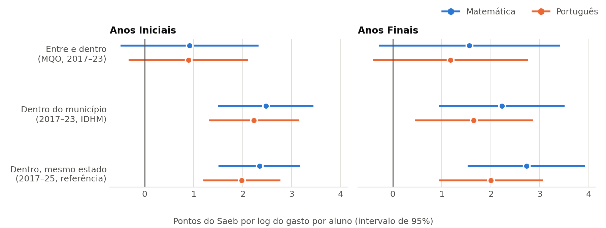
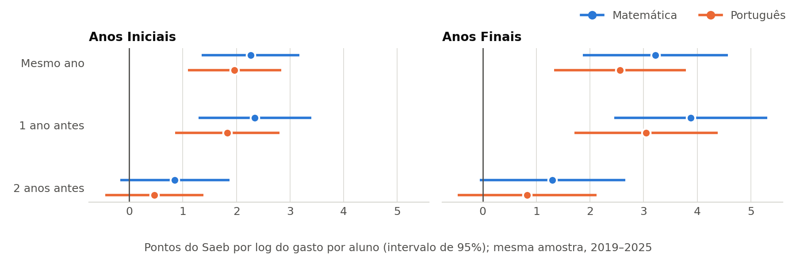
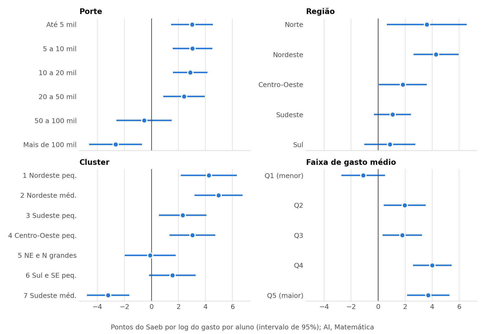
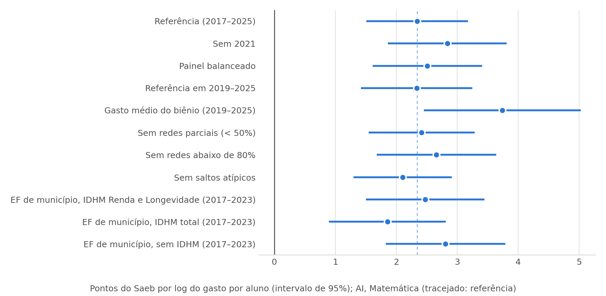

# Nota de resultados (para a redação)

*2026-11-11. Ponto de partida para os capítulos de Resultados e de Análise e discussão. Os números vêm das tabelas e figuras de `docs/resultados/` (geradas por `src/Analise/Material_Texto.py`); o registro completo, com as decisões e os cuidados, está em `docs/decisoes_metodo.md` (A4, A11, A12, A13). Toda leitura é de **associação**, não de efeito do gasto (A1).*

## Resumo em cinco frases

1. Entre os municípios, os que gastam mais por aluno têm notas um pouco maiores, mas essa associação simples vem caindo (ρ de 0,46 em 2017 para 0,16 em 2025) e some quando se controla o contexto.
2. Dentro do mesmo município, comparado com outros do mesmo estado na mesma edição, a associação é positiva, estável e **pequena**: +10% no gasto por aluno acompanha cerca de +0,2 ponto no Saeb, e dobrar o gasto, cerca de 1,6 ponto, quando um ano de escola vale perto de 25.
3. Essa associação vem do gasto do ano da prova e do ano anterior, e não do gasto de 2 ou 4 anos antes.
4. Ela se concentra nos municípios pequenos e no Nordeste e Norte; nas cidades com mais de 100 mil habitantes e no Sudeste e Sul, não aparece.
5. Na camada estadual, com 27 UFs, não é possível detectar associação: os intervalos são largos demais.

## 1. O gasto se associa à nota? (pergunta 1)

- **Associação simples** (Tabela 2): a correlação de Spearman entre gasto por aluno e proficiência em AI Matemática cai de 0,46 (2017) para 0,16 (2025). Ela é maior com o gasto de anos antes (em 2025: 0,30 com o gasto de 4 anos antes).
- **Com controles de contexto, entre municípios** (Tabela 3, primeira linha; Figura 1): o coeficiente do log do gasto cai para 0,9 ponto e deixa de ser significativo (p = 0,20). Ou seja, a correlação simples reflete sobretudo que municípios de contexto mais favorável gastam mais e têm notas maiores.
- **Para o texto:** "a correlação simples entre gasto e nota existe, mas se explica em grande parte pelo contexto dos municípios".

## 2. Dentro do mesmo município, mais gasto acompanha nota maior? (pergunta 2)

- **Especificação de referência** (A11): efeito fixo de município (compara o município com ele mesmo ao longo do tempo) e efeito de UF × edição (compara só com municípios do mesmo estado na mesma edição), 2017–2025, erros agrupados por município.
- **Resultado** (Tabela 3, última linha; Figura 1):

  | | Matemática | Português |
  |---|---|---|
  | Anos Iniciais | 2,34*** | 1,98*** |
  | Anos Finais | 2,73*** | 2,00*** |

  Em AI Matemática: +10% no gasto por aluno → +0,22 ponto; dobrar o gasto → +1,6 ponto.
- **Tamanho:** é pequeno. A escala do Saeb avança cerca de 25 pontos por ano de escolaridade, então dobrar o gasto se associa a algo como 6% de um ano de escola.
- **Por que a referência inclui o efeito de UF × edição:** sem ele, incluir 2025 dobrava o coeficiente. A investigação mostrou que, de 2023 a 2025, o Nordeste e o Norte tiveram ao mesmo tempo o maior aumento de gasto e o maior ganho de nota. Isso é compatível com a complementação VAAT do novo Fundeb, mas não foi testado (o painel não tem quem recebeu VAAT). O efeito de UF × edição retira esses movimentos comuns ao estado, e o coeficiente fica estável (2,3 com ou sem 2025). Ele também absorve o IDHM, que é da UF e do ano.
- **Para o texto:** "dentro do mesmo município, e descontados os movimentos comuns ao estado, aumentos de gasto acompanham notas um pouco maiores; a associação é estatisticamente clara, mas pequena".

## 3. Com que defasagem? (perguntas 1 e 2)

- **Na mesma amostra** (Tabela 4; Figura 2): contam o gasto do ano da prova e o do ano anterior (AI MT: 2,26 e 2,35); o de 2 anos antes não se associa (0,85, não significativo), e o de 4 anos antes também não (na janela em que existe).
- **Contraste com a correlação simples**, que cresce com a defasagem: lá, o gasto antigo carrega diferenças persistentes entre municípios, que o efeito fixo retira.
- **Para o texto:** "a associação dentro do município se concentra no gasto do próprio ciclo de avaliação do Saeb (os dois anos que antecedem a prova)". Com o gasto médio desses dois anos, o coeficiente sobe cerca de 60% (Tabela 6), o que reforça essa leitura.

## 4. E nas redes estaduais? (pergunta 4)

- **Resultado** (Tabela 7): com efeito fixo de UF, nenhum coeficiente se distingue de zero, em AF e EM, em nenhuma especificação, nem com a versão B do gasto, nem com o gasto pela soma das subfunções da educação básica (G4b).
- **Leitura correta:** "não detectável", e não "ausência de associação". Com 27 UFs, os intervalos de 95% vão de cerca de −6 a +9 pontos e incluem tanto zero quanto valores maiores que o municipal.
- **Para o texto:** a camada estadual fica descritiva, como no painel; o número de unidades é uma limitação (L8).

## 5. A relação muda por porte ou região? (pergunta 5)

- **Resultado** (Tabela 5; Figura 3, AI Matemática): as inclinações não são iguais entre os grupos (p ≤ 0,02 nas quatro dimensões).
  - **Porte:** 2,4 a 3,0 nos municípios de até 50 mil habitantes; −0,5 (não significativo) de 50 a 100 mil; **−2,65** acima de 100 mil.
  - **Região:** Nordeste 4,3 e Norte 3,6; Sudeste 1,1 e Sul 0,9, não significativos.
  - **Cluster:** maior nos clusters de maioria nordestina (1 e 2: 4,3 e 5,0); negativo no 7, de maioria do Sudeste e municípios médios (−3,2). O nome de cada cluster traz a região da maioria dos municípios, e não de todos.
  - **Faixa de gasto médio:** maior entre os que gastam mais (Q4–Q5: cerca de 4); nulo entre os que gastam menos (Q1).
- **Cuidados:**
  - as dimensões se sobrepõem: os municípios que mais gastam por aluno são, em geral, os menores (614 dos 1.063 do quintil mais alto têm até 5 mil habitantes);
  - **a associação negativa nas cidades grandes não tem explicação ainda.** Hipóteses a citar como tais, sem afirmar: o gasto da subfunção 361 nas cidades grandes mistura itens que não chegam à sala de aula; o gasto por aluno dessas redes varia mais com a entrada e saída de alunos; regressão à média;
  - são muitas comparações: os testes de igualdade passam com folga, mas não convém destacar um grupo isolado.

## 6. Os resultados se sustentam? (pergunta 6)

- **Testes** (Tabela 6; Figura 4): sem 2021 (pandemia), painel balanceado, sem redes parciais (abaixo de 50% e de 80%), sem saltos atípicos, gasto médio do biênio e variantes do IDHM.
- **Resultado:** todos os coeficientes municipais ficam positivos e significativos, entre 1,4 e 5,5 pontos por log do gasto.
- **IDHM total no lugar de Renda e Longevidade:** reduz o coeficiente, como se espera de um controle que contém a dimensão Educação. Isso sustenta a decisão C1b.
- **Camada estadual:** o gasto pela soma das subfunções da educação básica (G4b), feito em 2026-11-13, também não se distingue de zero (p de 0,17 a 0,94).

## O que não dizer

- "O gasto causa / melhora a nota": os modelos mostram associação.
- "Gastar mais não adianta": dentro do município, a associação é positiva; ela é pequena, e não nula.
- "O gasto estadual não tem relação com a nota": com 27 UFs, não dá para detectar; é diferente de não haver.
- "Gastar mais vale mais para quem gasta pouco": os dados mostram o contrário, mas confundido com o porte.
- Qualquer explicação para o resultado das cidades grandes ou para 2025 como fato: são hipóteses.

## Figuras

*Figura 1. Coeficiente do log do gasto por aluno na proficiência, entre municípios (MQO) e dentro do município, com intervalo de 95%.*

*Figura 2. Associação dentro do município por defasagem do gasto, na mesma amostra (2019–2025).*

*Figura 3. Associação dentro do município por porte, região, cluster e faixa de gasto médio (AI, Matemática).*

*Figura 4. Testes de sensibilidade (AI, Matemática); o tracejado marca a referência.*

## Para reproduzir

Na raiz do repositório, com o Python do ambiente do projeto, rodar em ordem:

1. `src/Analise/Modelo_Principal.py`
2. `src/Analise/Investigar_2025.py` (investigação de 2025; não alimenta as tabelas)
3. `src/Analise/Modelo_Estadual.py`
4. `src/Analise/Heterogeneidade.py`
5. `src/Analise/Sensibilidade_Modelo.py`
6. `src/Analise/Material_Texto.py` (tabelas e figuras)
